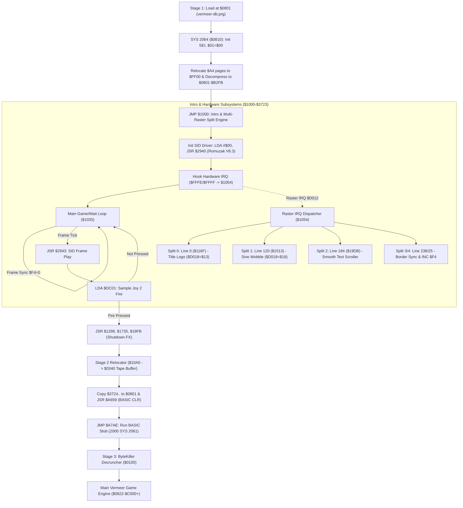
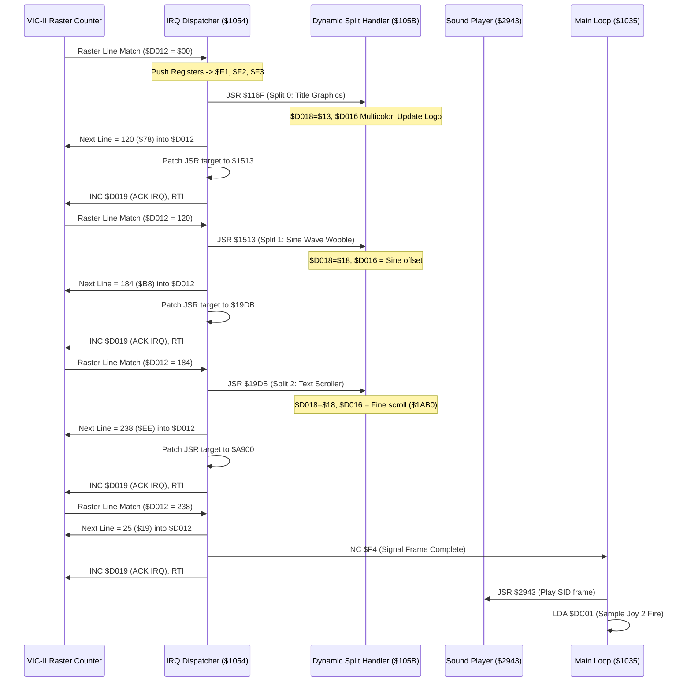
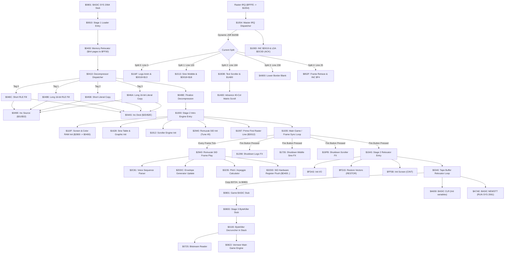

# Architecture Specification: Vermeer (Commodore 64)
**Target Binary Analysis:** `Disassembling/vermeer.asm` (Exported from JC64dis)  
**Binary Sources:** `Disassembling/vermeer-db.prg`, `Disassembling/vermeer-pic.prg`, `Disassembling/vermeer-db.d64`  
**Runtime Architecture:** 6502 Machine Code / Multi-Stage Self-Extracting Executable / Commodore 64

---

## 1. Executive Summary & System Overview

`vermeer.asm` represents a comprehensive disassembly (produced by JC64dis 3.2) of `vermeer-db.prg` (42,068 bytes, load address `$0801`). Analysis of the binary layout and code structure reveals that this release of Ralf Glau's classic 1987 Ariolasoft economic simulation *Vermeer* is packaged as a **three-stage multi-layered system**:

1. **Stage 1 (Primary Compressed Wrapper & Cracker Loader):**
   - Packaged by German cracking/demo group **Digital Marketing** (incorporating Oliver Blasnik's *Romuzak V6.3* audio engine and multi-raster split presentation).
   - Loads at `$0801` with a BASIC `SYS 2064` stub.
   - Contains an in-place decruncher (`$0810`–`$08CB`) that relocates `$A4` pages ($41,984 bytes) to high memory (`$FF00` downwards) and expands the runtime environment (`$0801`–`$B2FB`).

2. **Stage 2 (Intro Engine & Multi-Raster Display System):**
   - Executes at `$1000` with 6510 I/O register `$01 = $35` (all 64KB RAM banked in, I/O active at `$D000`–`$DFFF`).
   - Features a 5-zone raster interrupt dispatcher driven by `$D012` and `$D01A` that splits the screen into:
     - Top title graphics / multi-color logo (Charset at `$0800`, Screen at `$0400`).
     - Smooth horizontal sine-wobble raster split (Line 120, Charset at `$2000`).
     - Continuous horizontal smooth text scroller (Line 184, Charset at `$2000`).
     - Lower border management and frame synchronization.
   - Plays Oliver Blasnik's *Romuzak V6.3* SID music driver via per-frame IRQ tick (`$2943`).
   - Monitors Joystick Port 2 (`$DC01`) for the fire button to trigger the payload transition.

3. **Stage 3 (Payload Relocator & ByteKiller Decruncher):**
   - On user input, restores KERNAL vectors (`$FDA3`, `$FD15`, `$FF5B`), relocates a secondary loader to cassette buffer `$0340`, and copies the packed game image from `$3724` to `$0801`.
   - Re-enters BASIC at `$0801` (`2000 SYS 2061`), where Ariolasoft's native **ByteKiller** decompressor expands the full *Vermeer* game database into `$0822`–`$C000+`.
   - The game executes as a hybrid compiled BASIC / high-performance assembly engine managing auctions, plantation economics, world travel, and graphic rendering (`vermeer-pic.prg`).



---

## 2. Program Entry Points & Execution Lifecycle

### 2.1 Stage 1: Initial Loader & Memory Relocator (`$0801`–`$08CB`)

In `vermeer.asm`, JC64dis disassembled the file directly from `$0801`:

| Memory Addr | Disasm Label | ASM Line | Opcode Bytes | Instruction | Description |
|---|---|---|---|---|---|
| `$0801` | – | L10–L24 | `0E 08 1A 03 9E 32 30 36 34 ...` | `BASIC Header` | Line `802 SYS 2064` (`$0810`) |
| `$0810` | `W0810` | L25 | `78` | `SEI` | Disable maskable interrupts |
| `$0811` | `W0811` | L27 | `A9 00` | `LDA #$00` | Black color value |
| `$0813` | `W0813` | L29 | `8D 20 D0` | `STA $D020` | Blank border color |
| `$0816` | `W0816` | L31 | `85 01` | `STA $01` | Bank out all ROMs (full 64KB RAM access) |
| `$0818` | – | L33 | `A0 05` | `LDY #$05` | Pointer table length (6 bytes: `$2D`–`$32`) |
| `$081A` | `W081A` | L34 | `BE EA 08` | `LDX W08E9+1,Y` | Load relocation pointers from `$08EA` |
| `$081D` | – | L36 | `96 2D` | `STX $2D,Y` | Store into Zero Page `$2D`–`$32` |
| `$081F` | – | L37 | `88` | `DEY` | Loop decrement |
| `$0820` | `W0820` | L38 | `10 F8` | `BPL W081A` | Loop until 6 pointer bytes transferred |
| `$0822` | `W0822` | L40 | `B9 EA 07` | `LDA $07EA,Y` | Relocate decompressor loop code |
| `$0825` | – | L42 | `99 BA 03` | `STA $03BA,Y` | Store loop into cassette/screen buffer `$03BA`–`$04BA` |
| `$0828` | – | L43 | `88` | `DEY` | Decrement copy index |
| `$0829` | – | L44 | `D0 F7` | `BNE W0822` | Copy all 255 bytes |
| `$082B` | – | L45 | `A2 A4` | `LDX #$A4` | Number of pages to relocate ($A400 = 41,984 bytes) |
| `$082D` | – | L46 | `4C 00 04` | `JMP $0400` | Jump into relocated unpacking dispatcher |

#### Zero Page Pointers Initialized at `$08EA`:
- `$2D/$2E` = `$0801` (Destination decompression pointer)
- `$2F/$30` = `$AB53` (Relocation source pointer; moves to `$FF00`)
- `$31/$32` = `$5C9D` (Compressed bitstream source pointer)

#### Relocated Stage 1 Decompressor Algorithm (`$0400`–`$04AB` / `W0830`–`W08CB`):
The decompressor operates as a high-speed RLE / literal block expander reading 2-bit tag markers:
- **Tag `%00` (`W088C`, L109):** Short RLE fill. Read length `X = byte >> 2`, read single value byte, store `X` times.
- **Tag `%01` (`W089B`, L119):** Long 16-bit RLE fill. Count = `(X << 8) | next_byte`, read fill byte, store `count` times.
- **Tag `%02` (`W085B`, L78):** Short literal copy. Copy `X` raw bytes from stream.
- **Tag `%03` (`W086A`, L87):** Long 16-bit literal copy. Count = `(X << 8) | next_byte`, copy `count` raw bytes.
- **Termination (`W08BE`, L144):** When high byte of source pointer `$32` wraps to zero, decompression is complete (`$0801`–`$B2FB`). Sets `$AE/$AF = $2D/$2E`, sets `$01 = $37`, enables interrupts (`CLI`), and jumps to `JMP W1000`.

---

### 2.2 Stage 2: Intro Presentation Engine & Main Loop (`$1000`–`$10A4`)

In `vermeer.asm`, this code is disassembled at label `W0EAA` (L1231) through `W0EF3` (L1271) because the packed data stream in `vermeer-db.prg` was disassembled without prior expansion. In runtime memory, it executes at `$1000`–`$10A4`:

```asm
; --- INITIALIZATION AT $1000 (vermeer.asm: W0EAA, Line 1231) ---
$1000:  SEI
$1001:  LDA #$35            ; Bank in full RAM under BASIC/KERNAL, enable I/O at $D000
$1003:  STA $01
$1005:  JSR $110F           ; Initialize Screen RAM ($0400) & Color RAM ($D800) from $2800
$1008:  JSR $1628           ; Initialize raster split zone 1 parameters & sine tables
$100B:  JSR $1912           ; Initialize raster split zone 2 parameters & scroller text
$100E:  LDA #$00            ; Select Tune #0 (Oliver Blasnik's Romuzak soundtrack)
$1010:  JSR $2940           ; Sound Driver Init
$1013:  LDA #$01
$1015:  STA $DC0D           ; Disable CIA#1 timer interrupt sources
$1018:  STA $D01A           ; Enable VIC-II Raster Interrupts (bit 0 = 1)
$101B:  LDA #$54            ; Hook Hardware IRQ Vector in RAM
$101D:  STA $FFFE           ; IRQ Vector Low  = $54
$1020:  LDA #$10            ; IRQ Vector High = $10 ($FFFE -> $1054)
$1022:  STA $FFFF
$1025:  LDA #$1B            ; Screen Control: 25 rows, text mode, screen visible, raster bit 8 = 0
$1027:  STA $D011
$102A:  LDA #$00            ; Border color black
$102C:  STA $D020
$102F:  STA $F4             ; Reset frame sync flag ($F4 = 0)
$1031:  JSR $1097           ; Prime first raster IRQ target
$1034:  CLI                 ; Enable hardware interrupts
```

---

## 3. Main Game Loop Architecture

The main loop executes at `$1035`–`$1053` (`W0EDA`–`W0EF3` in `vermeer.asm`, lines 1256–1271):

```asm
; --- MAIN EXECUTION / FRAME SYNC LOOP (vermeer.asm: W0EDA, Line 1256) ---
$1035:  LDA $F4             ; Read frame synchronization flag
$1037:  BEQ $1035           ; Spin-wait until raster IRQ signals bottom of frame (INC $F4)
$1039:  DEC $F4             ; Acknowledge frame tick

$103B:  LDA $DC01           ; Read CIA#1 Port B (Joystick Port 2 & Keyboard row matrix)
$103E:  CMP #$EF            ; Test Joystick 2 Fire Button (Bit 4 low: $FF & ~$10 = $EF)
$1040:  BNE $104E           ; Fire not pressed -> continue normal frame execution

; --- FIRE BUTTON PRESSED: INITIATE STAGE 3 LAUNCH ---
$1042:  JSR $1298           ; Halt sprite animations and split zone 0 updates
$1045:  JSR $1735           ; Blank out middle split sine generators
$1048:  JSR $19FB           ; De-allocate scroller resources
$104B:  JMP $10A5           ; Jump to Stage 2 Relocator & KERNAL Restorer

; --- NORMAL FRAME EXECUTION ---
$104E:  JSR $2943           ; Call Romuzak SID Sound Driver: advance frame & update voices
$1051:  JMP $1035           ; Loop back to wait for next vertical blank
```

### Key Zero-Page & Synchronization Variables:
- `$F4`: **Frame Sync Flag.** Set to non-zero by Split 4 of the raster interrupt handler when the beam reaches line 25 of the next frame. Cleared by the main loop via `DEC $F4`.
- `$F1`: **Preserved Accumulator (A)** across raster IRQ invocations.
- `$F2`: **Preserved X Register** across raster IRQ invocations.
- `$F3`: **Preserved Y Register** across raster IRQ invocations.

---

## 4. Raster IRQ Handlers ($D012) & Multi-Raster Split Engine

The intro presentation relies on dynamic self-modifying code to service 5 raster zones per video frame without jitter.



### 4.1 Master Dispatcher (`$1054`–`$108E` / `vermeer.asm`: `W0EFA`–`W0F34`, lines 1273–1308)

```asm
$1054:  STA $F1             ; Save CPU registers in Zero Page
$1056:  STX $F2
$1058:  STY $F3

$105A:  JSR $10A4           ; Self-Modifying Target: patched to $105B/$105C dynamically!
$105D:  LDX $108F           ; Load current split table index (0..4)
$1060:  LDA $109A,X         ; Fetch next target raster line from table
$1063:  STA $D012           ; Program VIC-II Raster Line Compare register ($D012)
$1066:  TXA
$1067:  ASL A               ; Multiply split index by 2 (word offset)
$1068:  TAX
$1069:  LDA $1090,X         ; Fetch split handler routine address (Low Byte)
$106C:  STA $105B           ; Patch low byte of JSR target at $105A
$106F:  LDA $1091,X         ; Fetch split handler routine address (High Byte)
$1072:  STA $105C           ; Patch high byte of JSR target at $105A

$1075:  INX                 ; Advance split counter
$1076:  CPX #$05            ; All 5 splits serviced?
$1078:  NOP
$1079:  BNE $1082           ; If not last split, continue
$107B:  LDA #$FF            ; Reset split index to -1 (will be incremented to 0)
$107D:  STA $108F
$1080:  INC $F4             ; Flag full frame complete -> wake up main loop!

$1082:  INC $108F           ; Advance split index
$1085:  JSR $109D           ; Acknowledge Interrupts:
                            ;   $109D: INC $D019 (Clear VIC raster latch)
                            ;   $10A0: LDA $DC0D (Clear CIA#1 pending IRQs)
                            ;   $10A3: RTS
$1088:  LDA $F1             ; Restore CPU registers
$108A:  LDX $F2
$108C:  LDY $F3
$108E:  RTI                 ; Return from Interrupt
```

### 4.2 Raster Split Table & Zone Breakdown

| Split ID | Raster Line ($D012) | Routine Vector ($1090) | ASM Ref in `vermeer.asm` | VIC Mode / Memory Setup | Zone Visual Purpose |
|---|---|---|---|---|---|
| **0** | Line 0 (`$00`) | `$116F` | `W116C+3` (L1668) | `$D018 = $13`<br>`$D016` multi-color | Upper Screen: Display multi-color Ariolasoft / Digital Marketing title logo using custom font at `$0800` and Screen Matrix at `$0400`. Background colors `$D022/$D023` updated. |
| **1** | Line 120 (`$78`) | `$1513` | `W1512+1` (L2213) | `$D018 = $18`<br>`$D016` sine offset | Middle Screen: Switch character generator to `$2000`. Modulates horizontal scroll bits of `$D016` via precalculated sine table `$17AD,X` to produce smooth waving wobble effect. |
| **2** | Line 184 (`$B8`) | `$19DB` | `W19D4+7` (L2950) | `$D018 = $18`<br>`$D016 = $1AB0` | Lower Screen: Smooth continuous text scroller. Calls `$1AB2` to advance fine scroll counter `$1AB0` and shift 40-column matrix left when 8 pixels traversed. |
| **3** | Line 238 (`$EE`) | `$A900` | `WA900` (L1312) | `$D011` border blank | Bottom Border Blanking: Prepares VIC-II registers for overscan / border transition. |
| **4** | Line 25 (`$19`) | `$852F` | `W852F` | `$D011 = $1B` | Vertical Retrace / Wrap: Signals vertical frame tick (`INC $F4`), resets raster to Line 0. |

---

## 5. Hardware Interface Mapping

### 5.1 VIC-II Video Controller ($D000–$D02E)

| Register | Address | ASM Line | Opcode & Operands | Subsystem Function |
|---|---|---|---|---|
| **Sprite 2 Y** | `$D005` | L8006 | `SLO $D005,X` | Sprite vertical position tracking |
| **Sprite 4 X** | `$D008` | L21824 | `INC $D008,X` | Dynamic horizontal sprite coordinate animation |
| **Sprite 5 Y** | `$D00B` | L18782 | `SHX $D00B,Y` | Dynamic vertical sprite positioning |
| **Screen Control 1** | `$D011` | L1249 | `STA $D011` | Intro Init: sets 25-row mode, display enable, text mode (`#$1B`) |
| | | L4579 | `STA $D011` | Romuzak Driver: resets screen control during sound playback (`#$1B`) |
| **Raster Line** | `$D012` | L1281 | `STA $D012` | Raster IRQ Dispatcher: programs next split line from `$109A,X` |
| | | L2051 | `CMP $D012` | Raster Sync: spin-waits for specific raster scanline |
| | | L2782 | `LDA $D012` | Raster Counter: reads current beam position for timing |
| | | L4576 | `STX $D012` | Romuzak Sound IRQ: initializes raster comparator to Line 1 |
| **Control Register 2** | `$D016` | L1446 | `STA $D016` | Split 0: enables multi-color mode (`#$10` / `#$18`) |
| | | L2026 | `STA $D016` | Split 1: smooth horizontal pixel scrolling via sine wave |
| | | L2637 | `STA $D016` | Split 2: smooth text scroll fine displacement (`$1AB0`) |
| **Memory Control** | `$D018` | L1442 | `STA $D018` | Split 0: Screen at `$0400`, Charset at `$0800` (`#$13`) |
| | | L2014 | `STA $D018` | Split 1: Screen at `$0400`, Charset at `$2000` (`#$18`) |
| | | L2633 | `STA $D018` | Split 2: Screen at `$0400`, Charset at `$2000` (`#$18`) |
| | | L23915 | `STA $D018` | Game Graphics: re-points matrix and font generator |
| **Interrupt Indicator**| `$D019` | L1318 | `INC $D019` | Master IRQ: clears VIC-II raster interrupt latch (write 1 to bit) |
| | | L4584 | `ASL $D019` | Romuzak IRQ: acknowledges raster interrupt |
| **Interrupt Mask** | `$D01A` | L1241 | `STA $D01A` | Master IRQ: enables raster interrupts (`#$01`) |
| | | L4577 | `STX $D01A` | Romuzak IRQ: enables raster interrupt generation (`#$01`) |
| **Border Color** | `$D020` | L30 | `STA $D020` | Stage 1 Decruncher: sets border to black (`#$00`) |
| | | L1252 | `STA $D020` | Stage 2 Intro: sets border to black (`#$00`) |
| | | L1331 | `STX $D020` | Stage 2 Exit: resets border color |
| | | L2083 | `STX $D020` | Split boundary raster bar color pulse |
| | | L2549 | `STA $D020` | Visual effect border flashing |
| | | L2791 | `STA $D020` | Raster bar palette modulation |
| | | L2809 | `STX $D020` | Raster bar palette modulation |
| **Background 0** | `$D021` | L1332 | `STX $D021` | Stage 2 Exit: resets background color |
| | | L2064 | `STA $D021` | Split zone background color 0 update |
| | | L2084 | `STX $D021` | Split boundary raster bar background |
| | | L2792 | `STA $D021` | Raster bar background modulation |
| | | L2810 | `STX $D021` | Raster bar background modulation |
| **Background 1** | `$D022` | L1450 | `STA $D022` | Split 0: sets Multi-color 1 from table `$110A+1` |
| | | L2016 | `STA $D022` | Split 1: sets Multi-color 1 from table `$1511` |
| | | L2639 | `STA $D022` | Split 2: sets Multi-color 1 from table `$190B` |
| **Background 2** | `$D023` | L1452 | `STA $D023` | Split 0: sets Multi-color 2 from table `$110C` |
| | | L2018 | `STA $D023` | Split 1: sets Multi-color 2 from table `$1512` |
| | | L2641 | `STA $D023` | Split 2: sets Multi-color 2 from table `$190C` |
| **Background 3** | `$D024` | L2062 | `STA $D024` | Extra multi-color background register in extended color modes |
| | | L2075 | `STA $D024` | Extra multi-color background register in extended color modes |
| **Sprite Multicolor 1**| `$D026` | L16024 | `DCP $D026` | Dynamic sprite multi-color register animation |
| **Sprite Colors** | `$D027`..`$D02E`| L21801 | `STA $D027,Y` | Sets individual sprite colors 0..7 indexed by Y |

---

### 5.2 SID Sound Interface ($D400–$D41C)

The game incorporates the complete **Oliver Blasnik Romuzak V6.3** SID music driver (signature at `$24D4` / L4540 in `vermeer.asm`). The driver is indexed by voice offsets: Voice 1 (`Y=0`), Voice 2 (`Y=7`), Voice 3 (`Y=14`).

| Register | Address | ASM Line | Opcode & Operands | Function & Sound Driver Subsystem |
|---|---|---|---|---|
| **Voice 1 Freq Low** | `$D400` | L5659 | `STA $D400,Y` | Note Pitch Low Byte (computed from frequency table `$2985`) |
| **Voice 1 Freq High** | `$D401` | L5662 | `STA $D401,Y` | Note Pitch High Byte (computed from frequency table `$29E2`) |
| **Voice 1 Pulse Low** | `$D402` | L5655 | `STA $D402,Y` | Pulse Width Low: dynamic modulation from instrument table |
| **Voice 1 Pulse High**| `$D403` | L5657 | `STA $D403,Y` | Pulse Width High: 12-bit duty cycle modulation |
| **Voice 1 Control** | `$D404` | L4642 | `STA $D404` | Global Silence: clears Gate, Triangle, Saw, Pulse, Noise |
| | | L4897 | `STA $D404,Y` | Gate Off: initiates release phase on note end |
| | | L4966 | `STA $D404,Y` | Gate On: triggers attack phase with selected waveform |
| | | L5653 | `STA $D404,Y` | Waveform Select: Triangle (`$10`), Saw (`$20`), Pulse (`$40`), Noise (`$80`) |
| | | L22955 | `ASL $D404` | Direct hardware bit manipulation |
| **Voice 1 Attack/Decay**|`$D405` | L4968 | `STA $D405,Y` | ADSR Envelope: Attack time (bits 4-7) & Decay time (bits 0-3) |
| **Voice 1 Sustain/Rel** |`$D406` | L4970 | `STA $D406,Y` | ADSR Envelope: Sustain level (bits 4-7) & Release time (bits 0-3) |
| **Voice 2 Control** | `$D40B` | L4643 | `STA $D40B` | Global Silence: resets Voice 2 control register |
| | | L22118 | `EOR $D40B,X` | Voice 2 state check / toggle |
| **Voice 3 Pulse High**| `$D411` | L15716 | `LSR $D411,X` | Pulse width duty modulation |
| **Voice 3 Control** | `$D412` | L4644 | `STA $D412` | Global Silence: resets Voice 3 control register |
| | | L22119 | `STA $D412` | Waveform control write |
| **Filter Cutoff High** | `$D416` | L5712 | `STA $D416` | Filter Cutoff Frequency (high 8 bits of 11-bit filter cutoff) |
| **Filter Resonance** | `$D417` | L5122 | `STA $D417` | Filter Resonance (bits 4-7) & Voice routing (bits 0-2 = V1, V2, V3) |
| | | L5718 | `STA $D417` | Dynamic filter resonance modulation |
| **Master Volume/Mode** | `$D418` | L5709 | `STA $D418` | Master Volume (`$0F` = max volume) & Low-pass/Band-pass/High-pass select |
| | | L22121 | `STA $D418` | Volume / filter mode write |

---

### 5.3 CIA Interfaces ($DC00–$DC0F, $DD00–$DD0F) & Joystick

| CIA Chip | Register | Address | ASM Line | Opcode & Operands | Function & System Purpose |
|---|---|---|---|---|---|
| **CIA #1** | **Port A (Joy 1 / Matrix)** | `$DC00` | L24120 | `LDA $DC00` | Keyboard Matrix column strobe & Joystick Port 1 input read |
| **CIA #1** | **Port B (Joy 2 / Matrix)** | `$DC01` | L1260 | `LDA $DC01` | **Joystick Port 2 Read:** checks fire button (`#$EF`) to exit intro |
| **CIA #1** | **Interrupt Control** | `$DC0D` | L1239 | `STA $DC0D` | **Interrupt Mask:** writes `#$01` to disable CIA timer IRQ generation |
| | | | L1319 | `LDA $DC0D` | **Interrupt ACK:** reads `$DC0D` inside raster IRQ to clear pending CIA IRQs |
| **CIA #1** | **Timer A Control** | `$DC0E` | L4574 | `STX $DC0E` | Stops Timer A (`#$00`) during sound player initialization |
| **CIA #2** | **Timer A High Byte** | `$DD05` | L10450 | `BIT $DD05` | Timer test / delay counter |
| **CIA #2** | **Port A (VIC Bank Select)**| `$DD00` | – | Indirect | Sets bits 0-1 for VIC-II 16KB bank selection (Bank 0 = `$0000`–`$3FFF`) |

---

## 6. Complete Subroutine Call Graph

### 6.1 Call Hierarchy



### 6.2 Primary Subroutine Directory

| Subroutine Address | Label in `vermeer.asm` | ASM Line | Purpose & Subsystem | Callers | Callees |
|---|---|---|---|---|---|
| `$0400` | `W0830` | L48 | Stage 1 memory relocation loop ($A4 pages to `$FF00`) | `W0822` | Loop in-place |
| `$0410` | `W0840` | L59 | Stage 1 decompression dispatch loop | `$0400` | `$045B`, `$046A`, `$048C`, `$049B` |
| `$049E` | `W08CE` | L156 | Increment source pointer `$31/$32` | 6 routines | Self |
| `$04A5` | `W08D5` | L162 | Increment destination pointer `$2D/$2E` | 4 routines | Self |
| `$1000` | `W0EAA` | L1231 | Stage 2 Intro Engine initialization | `W08BE` | `$110F`, `$1628`, `$1912`, `$2940`, `$1097` |
| `$1035` | `W0EDA` | L1256 | Main game execution loop & fire button monitor | `$1000`, `$1051` | `$1298`, `$1735`, `$19FB`, `$10A5`, `$2943` |
| `$1054` | `W0EFA` | L1276 | Master Raster IRQ Entry Point (`$FFFE`) | Hardware IRQ | Dynamic `JSR $105B`, `$109D` |
| `$109D` | `W0F41` | L1316 | Interrupt Acknowledge (`INC $D019; LDA $DC0D`) | `$1054` | Return (`RTS`) |
| `$10A5` | `W0F4D` | L1326 | Transition Relocator Setup & KERNAL Restorer | `$1035` | `$FDA3`, `$FD15`, `$FF5B`, `$0340` |
| `$110F` | `W110E+1` | L1611 | Copy Intro Screen Matrix from `$2800` to `$0400` & init `$D800` | `$1000` | Internal loops |
| `$116F` | `W116C+3` | L1668 | Split 0 Handler: Title logo multi-color & animation | `$105B` | Internal updates |
| `$1298` | `W1298` | L1841 | Shutdown upper split logo animation | `$1035` | Return |
| `$1513` | `W1512+1` | L2213 | Split 1 Handler: Sine-wave horizontal wobble | `$105B` | Precomputed sine read |
| `$1628` | `W1628` | L2385 | Initialize middle zone sine tables | `$1000` | Internal math |
| `$1735` | `W1733+2` | L2543 | Shutdown middle split generators | `$1035` | Return |
| `$1912` | `W1912` | L2847 | Initialize text scroller pointers & buffer | `$1000` | Internal string setup |
| `$19DB` | `W19D4+7` | L2950 | Split 2 Handler: Smooth horizontal text scroller | `$105B` | `$1AB2` |
| `$19FB` | `W19FB` | L2973 | Shutdown text scroller | `$1035` | Return |
| `$1AB2` | `W1AB2` | L3040 | Shift 40-column text matrix left by 1 character | `$19DB` | Matrix copy loop |
| `$2940` | `W293F+1` | L5157 | Romuzak SID Driver: Music & Sound Init (Tune in A) | `$1000` | `$2FA0`, internal tables |
| `$2943` | `W2942+1` | L5158 | Romuzak SID Driver: Per-frame IRQ Sound Tick | `$1035`, `$2545` | `$2C81`, `$2DDC`, `$3235`, `$32DD` |
| `$32DD` | `W32DD` | L6620 | Flush voice parameters to SID registers (`$D400`..) | 8 routines | Voice hardware writes |
| `$0340` | `W10C8` | L1334 | Stage 2 Cassette Buffer Relocator (copies `$3724` to `$0801`) | `$10A5` | `$A659`, `$A7AE` |
| `$0100` | `W080D` | L14 | Stage 3 ByteKiller in-place game decompressor | `$080D` | `$0725`, `$0726`, `$0822` |
| `$0725` | `W0725` | – | ByteKiller Bitstream bit-reader | 4 routines | Internal shift |
| `$0726` | `W0726` | – | ByteKiller multi-bit reader | 4 routines | Internal shift |
| `$0822` | `W0822` | – | Main Vermeer Game Engine Entry Point | ByteKiller exit | Game subsystems |

---

## 7. Complete System Memory Map

### 7.1 Zero Page Allocation (`$00`–`$FF`)

| Zero Page Address | Subsystem Ownership | Variable Purpose |
|---|---|---|
| `$00` | 6510 On-Chip | 6510 On-Chip I/O Port Data Direction Register |
| `$01` | 6510 On-Chip | **Memory Banking Configuration:**<br>• `$00`: Full 64KB RAM, ROMs/IO off (Stage 1 Loader)<br>• `$35`: RAM under BASIC/KERNAL, I/O at `$D000`–`$DFFF` (Intro & IRQ)<br>• `$37`: Default C64 banking with BASIC & KERNAL active |
| `$02` / `$03` | Intro Split 0 | Zero Page indirect pointer to character screen buffer (`$0400`) |
| `$10` | Romuzak Driver | Temporary channel calculation register |
| `$11` / `$12` | ByteKiller | Bitstream read pointers and length accumulator |
| `$2D` / `$2E` | Stage 1 Decruncher | **Destination Address Pointer** (initialized to `$0801`) |
| `$2F` / `$30` | Stage 1 Decruncher | **Relocation Source Pointer** (initialized to `$AB53`) |
| `$31` / `$32` | Stage 1 Decruncher | **Compressed Stream Pointer** (initialized to `$5C9D`) |
| `$48` / `$49` | ByteKiller | Match offset pointer |
| `$8B` / `$8C` | Stage 1 Decruncher | 16-bit block run-length counter |
| `$F1` | Master IRQ | **A Register Backup** across raster interrupts |
| `$F2` | Master IRQ | **X Register Backup** across raster interrupts |
| `$F3` | Master IRQ | **Y Register Backup** across raster interrupts |
| `$F4` | Master IRQ / Main | **Frame Synchronization Flag:** incremented by Split 4, decremented by `$1035` |
| `$F8` | Romuzak Driver | Sound envelope pointer |
| `$FA` / `$FB` | Stage 2 Relocator | Destination copy pointer (`$0801`) / ByteKiller bit buffer |
| `$FC` / `$FD` | Stage 2 Relocator | Source copy pointer (`$3724`) |
| `$FE` / `$FF` | ByteKiller | Source stream sliding window pointer |

---

### 7.2 Full 64KB System Memory Map

| Address Range | Size | Allocation in Stage 1 (`vermeer-db.prg`) | Allocation in Stage 2 (Unpacked Intro Runtime) | Allocation in Stage 3 (Final Vermeer Game) |
|---|---|---|---|---|
| `$0000`–`$00FF` | 256 B | Zero Page registers / pointers | Zero Page IRQ variables & audio state | C64 KERNAL / BASIC Zero Page & game variables |
| `$0100`–`$01FF` | 256 B | CPU Stack | CPU Stack | CPU Stack & ByteKiller decompressor engine |
| `$0200`–`$033F` | 320 B | Operating system storage | OS vectors & input buffers | Keyboard queue, KERNAL vectors |
| `$0340`–`$03FF` | 192 B | Cassette Buffer (holds relocator) | Cassette Buffer: **Stage 2 Relocator (`$10C8`)** | Cassette Buffer & temporary storage |
| `$0400`–`$07E7` | 1000 B | Decompressor scratch RAM | **Active Video Matrix (Intro Screen)** | **Active Video Matrix (Vermeer Game Screen)** |
| `$07E8`–`$07FF` | 24 B | Sprite pointers storage | **Active Sprite Pointers** (`$07F8`–`$07FF`) | Game Sprite Pointers |
| `$0800`–`$0FFF` | 2048 B | Stage 1 Decruncher & packed header | **Charset 1: Title Logo Multi-Color Font** | **Main Vermeer Program Code (`$0822`..)** |
| `$1000`–`$1FFF` | 4096 B | Raw packed bitstream (JC64dis code) | **Intro Presentation Engine & Raster IRQs:**<br>• `$1000`–`$10A4`: Engine & Main Loop<br>• `$1054`–`$108E`: Raster IRQ Dispatcher<br>• `$116F`–`$14FF`: Split 0 Logo Handler<br>• `$1513`–`$18FF`: Split 1 Sine Wobbler<br>• `$19DB`–`$1CFF`: Split 2 Text Scroller | Main Vermeer Program Code & Databases |
| `$2000`–`$27FF` | 2048 B | Raw packed bitstream | **Charset 2: Text & Scroller Multi-Color Font** | Game Text & Table Storage |
| `$2800`–`$2BFF` | 1024 B | Raw packed bitstream | **Intro Screen Matrix Backup** (source for `$0400`) | Game Map / Screen Buffers |
| `$2C00`–`$2FFF` | 1024 B | Raw packed bitstream | **16 Multi-Color Sprites** (pointers `$B0`–`$BF`) | Game Sprites / UI Elements |
| `$3000`–`$33FF` | 1024 B | Raw packed bitstream | **Oliver Blasnik Romuzak V6.3 Engine** | Sound Effects & Music Player |
| `$3400`–`$3723` | 804 B | Raw packed bitstream | **Romuzak Audio Pattern & Orderlist Data** | Music & Audio Sequences |
| `$3724`–`$B2FB` | 31,704 B | Raw packed bitstream (`vermeer-db.prg` payload) | **Stage 3 Vermeer Game Image:**<br>Copied to `$0801` on fire button press | Expanded Vermeer Game World, Auction Data, Commodity Tables, City Graphs |
| `$B24D`–`$B2FB` | 175 B | End of packed image | **Stage 3 ByteKiller Unpacker Image** | Transient unpacker storage |
| `$D000`–`$D3FF` | 1024 B | I/O: VIC-II Controller registers | I/O: VIC-II Controller registers | I/O: VIC-II Controller registers |
| `$D400`–`$D7FF` | 1024 B | I/O: SID Sound Synthesizer registers | I/O: SID Sound Synthesizer registers | I/O: SID Sound Synthesizer registers |
| `$D800`–`$DBE7` | 1000 B | Color RAM | Color RAM (Multi-color character attributes) | Color RAM (Game screen color attributes) |
| `$DC00`–`$DCFF` | 256 B | I/O: CIA #1 (Keyboard, Joy 2, IRQ) | I/O: CIA #1 (Joystick 2 fire detection) | I/O: CIA #1 (Game joystick & keyboard input) |
| `$DD00`–`$DDFF` | 256 B | I/O: CIA #2 (VIC-II Bank, Serial Bus) | I/O: CIA #2 (VIC Bank 0 active) | I/O: CIA #2 (VIC Bank & 1541 Disk I/O) |
| `$E000`–`$FFFF` | 8192 B | Relocation target for decruncher | Underlying RAM: available for code/data | KERNAL ROM or High RAM |
| `$FFFE`–`$FFFF` | 2 B | IRQ Vector | Vector points to `$1054` (RAM) | Default KERNAL IRQ (`$EA31`) |
